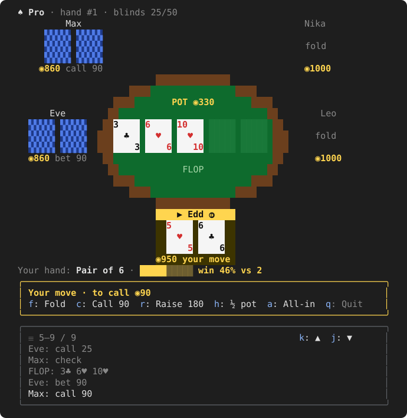
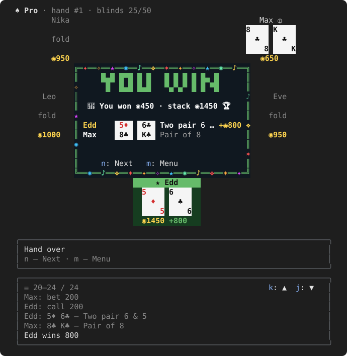
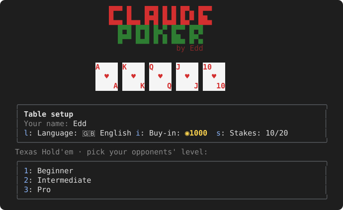

# ♠ Claude Poker

**8-bit Texas Hold'em that lives in a Claude Code side pane — play a hand while Claude writes your code.**


<p align="center">
  
</p>

## Features

- **A real table in your terminal** — green felt, wooden rail, pixel cards, players seated around you; the player to act is highlighted
- **1–6 AI opponents, three skill levels**
  - **Beginner** — loose and passive calling stations that raise at random
  - **Intermediate** — play their hand strength against the pot odds
  - **Pro** — Monte Carlo equity, traps, semi-bluffs, and they adapt to how aggressive you are
- **Hand hint and win odds** — your current hand (`Pair of 9`, `A K suited`) and your chance to win against the players still in, with a colour bar
- **Table setup** — your name, buy-in (500–10,000) and stakes (5/10 up to 100/200)
- **10 languages** — English, 中文, Español, Français, Deutsch, 日本語, Português, Русский, 한국어, Italiano (picked from `LANG`, switchable in the menu)
- **Paced play** — bots think for a moment before they act, so you can follow every move
- **Hand results on the table** — the showdown is revealed, then a banner (with confetti when you win)
- Side pots, all-ins, blinds that rise every 10 hands, a scrollable hand log, a confirmed quit
- Your game, settings and stats are saved between sessions
- No dependencies, no network, no API key — it runs entirely inside Claude Code

<p align="center">
  
  
</p>

## Install

You need [Claude Code](https://claude.com/claude-code) with plugin support.

### From inside Claude Code (recommended)

Type at the Claude Code prompt:

```
/plugin install poker --marketplace eddundead/claude-poker
```

1. Answer `y` to **Add marketplace?**
2. Pick a scope — **user** makes it available in every project
3. Done: the plugin is active right away. Type `/poker` to play.

### From your shell

```bash
claude plugin marketplace add eddundead/claude-poker
claude plugin install poker@claude-poker
```

### From a local clone

```bash
git clone https://github.com/eddundead/claude-poker.git
claude plugin marketplace add ./claude-poker
claude plugin install poker@claude-poker
```

Or try it for one session without installing:

```bash
claude --plugin-dir ./claude-poker
```

### Update

```bash
claude plugin marketplace update claude-poker
claude plugin update poker@claude-poker
```

### Uninstall

```bash
claude plugin uninstall poker@claude-poker
```

## Play

```
/poker              open the pane: menu and table setup
/poker pro 3        start straight away: skill level + number of opponents
/poker ja           switch language (en zh es fr de ja pt ru ko it)
```

The pane looks best in Claude Code's fullscreen layout on a terminal at least 110 columns wide, where it docks beside the conversation. Press `ctrl+x tab` to move into the pane and `Esc` to get back to the prompt — the game waits while you work.

### Controls

| Key | Action |
|---|---|
| `l` / `i` / `s` | language / buy-in / stakes (menu) |
| `1` `2` `3` | skill level (menu) |
| `1` … `6` | number of opponents |
| `f` | fold |
| `c` | check / call |
| `r` | minimum raise |
| `h` | raise half the pot |
| `p` | raise the pot |
| `a` | all-in |
| `k` / `j` | scroll the hand log up / down |
| `q` | quit to the menu (asks `y` / `n`) |
| `n` | next hand / new game |
| `m` | menu |
| `ctrl+x tab` | focus the pane from the prompt |
| `Esc` | back to the prompt |

## How it works

Claude Poker is a Claude Code plugin made of function hooks: a slash command (`/poker`) and a pane drawn with Claude Code's own UI elements. The table is painted cell by cell onto a small canvas, so it renders the same in any terminal with truecolor support. The game engine is plain TypeScript with no dependencies — a 7-card hand evaluator, side-pot settlement and Monte Carlo equity for the bots and the odds hint.

```
hooks/
  engine.ts     rules, hand evaluation, side pots, bots
  table.ts      the 8-bit table, cards and result banner
  i18n.ts       the ten languages
  register.tsx  the /poker command and the pane
types/          the plugin's state contract
tests/          engine and UI tests
```

## Development

```bash
claude plugin validate .   # check the manifest and hooks
claude plugin test .       # run the tests
claude --plugin-dir .      # play your working copy
```

---

Made by **Edd**.

**Keywords:** claude code plugin, claude code game, anthropic claude, texas hold'em, poker, terminal game, cli game, tui, 8-bit, pixel art, card game, ai poker bots, monte carlo poker odds, play while coding
